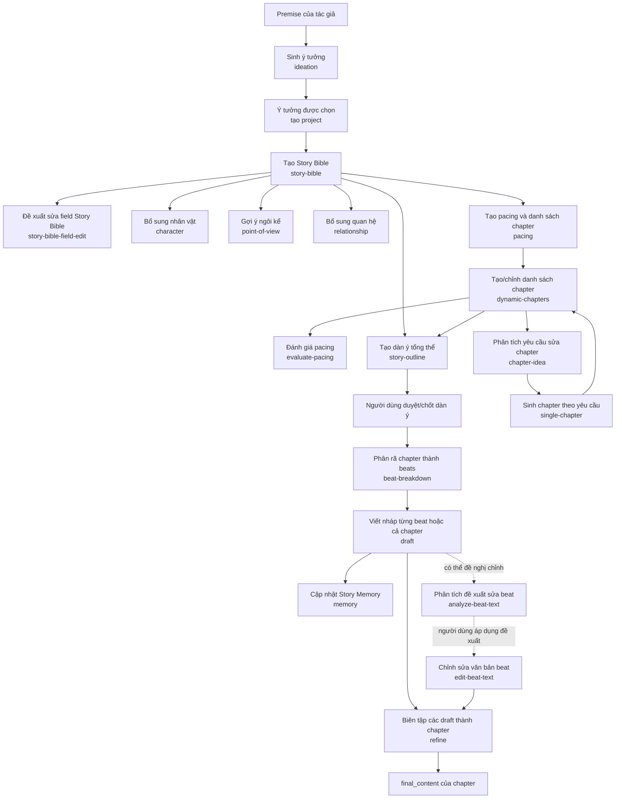
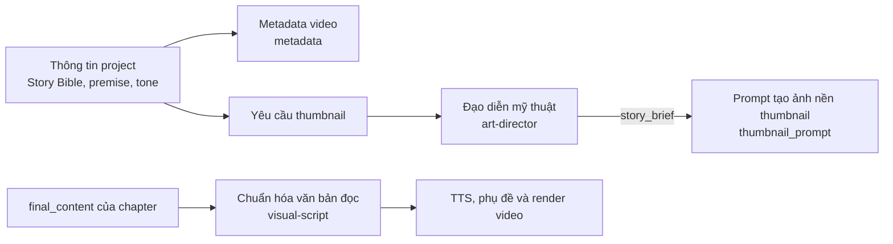

# Sơ đồ quan hệ giữa các prompt

Sơ đồ này mô tả các prompt Markdown hiện có trong `backend/prompts/` và cách backend ghép/gọi chúng. Mũi tên thể hiện luồng dữ liệu hoặc bước thường nối tiếp; các nhánh có thể được chạy riêng tùy thao tác của người dùng.

## 1. Luồng sáng tác và hoàn thiện truyện

**Lưu ý luồng:**

- `pacing` tự tạo chapter từ Story Bible; chapter cũng có thể được tạo/chỉnh bằng tay hoặc qua cặp `analyze-chapter-idea` → `single-chapter`.
- `evaluate-pacing` là bước đánh giá riêng trên Story Bible và danh sách chapter, không tự sửa chapter.
- Luồng `generate-all-beats` yêu cầu dàn ý đã được chốt và còn khớp với Bible/chapter. API `generate-beats` cho một chapter cũng có thể gọi trực tiếp mà không cần dàn ý đã chốt.
- Draft một chapter chạy lần lượt qua các beat và cập nhật memory giữa các beat. Draft một beat riêng cũng kích hoạt cập nhật memory ở tác vụ nền.
- `analyze-beat-text` chỉ phân tích/đề xuất. Người dùng quyết định nội dung yêu cầu cho `edit-beat-text`; chỉnh sửa không tự động chạy phân tích.

## 2. Luồng metadata, thumbnail và render

`thumbnail_prompt.md` là chỉ dẫn tạo ảnh được ghép với `story_brief` do cặp art-director tạo ra; nó không phải cặp system/user gửi tới `generate_json`. Metadata và thumbnail là nhánh riêng, không phụ thuộc vào việc render chapter.

## 3. Cặp prompt và biến thể phong cách

Các prompt sáng tác dưới đây được khai báo trong `CREATIVE_PROMPT_CATALOG` tại `backend/core/story_prompts.py`. Mỗi cặp gồm một user prompt dùng chung và system prompt được chọn theo `literary_style`:

| Giai đoạn / tác vụ | User prompt dùng chung | System prompt theo phong cách |
|---|---|---|
| `ideation` | `ideation_user.md` | `style_variants/{audio_story,literary_book}/ideation_system.md` |
| `story-bible` | `story_bible_user.md` | `style_variants/{audio_story,literary_book}/story_bible_system.md` |
| `story-bible-field-edit` | `story_bible_field_edit_user.md` | `story_bible_field_edit_system.md` |
| `character` | `add_character_user.md` | `style_variants/{audio_story,literary_book}/add_character_system.md` |
| `point-of-view` | `regenerate_pov_user.md` | `style_variants/{audio_story,literary_book}/regenerate_pov_system.md` |
| `relationship` | `add_relationship_user.md` | `style_variants/{audio_story,literary_book}/add_relationship_system.md` |
| `pacing` | `pacing_user.md` | `style_variants/{audio_story,literary_book}/pacing_system.md` |
| `evaluate-pacing` | `evaluate_pacing_user.md` | `style_variants/{audio_story,literary_book}/evaluate_pacing_system.md` |
| `analyze-chapter-idea` | `analyze_chapter_idea_user.md` | `style_variants/{audio_story,literary_book}/analyze_chapter_idea_system.md` |
| `single-chapter` | `single_chapter_user.md` | `style_variants/{audio_story,literary_book}/single_chapter_system.md` |
| `story-outline` | `story_outline_user.md` | `style_variants/{audio_story,literary_book}/story_outline_system.md` |
| `beat-breakdown` | `beat_user.md` | `style_variants/{audio_story,literary_book}/beat_system.md` |
| `draft` | `draft_user.md` | `style_variants/{audio_story,literary_book}/draft_system.md` |
| `memory` | `memory_user.md` | `style_variants/{audio_story,literary_book}/memory_system.md` |
| `analyze-beat-text` | `analyze_beat_text_user.md` | `style_variants/{audio_story,literary_book}/analyze_beat_text_system.md` |
| `edit-beat-text` | `edit_beat_text_user.md` | `style_variants/{audio_story,literary_book}/edit_beat_text_system.md` |
| `refine` | `refine_user.md` | `style_variants/{audio_story,literary_book}/refine_system.md` |

`{audio_story,literary_book}` đại diện cho hai file riêng, một file trong mỗi thư mục `backend/prompts/style_variants/audio_story/` và `backend/prompts/style_variants/literary_book/`. Mỗi phong cách hiện có 16 system prompt. User prompt không có biến thể theo phong cách.

## 4. Prompt bổ trợ ngoài catalog sáng tác

| Prompt | Vai trò / cách kết nối |
|---|---|
| `art_director_system.md` + `art_director_user.md` | Nhận diện project/Bible và tạo `story_brief` cho yêu cầu thumbnail. |
| `thumbnail_prompt.md` | Nhận `story_brief` từ art-director để tạo chỉ dẫn ảnh nền. |
| `metadata_system.md` + `metadata_user.md` | Tạo metadata theo `target_type` và `tone` từ thông tin project/Bible. |
| `visual_script_system.md` + `visual_script_user.md` | Chuẩn hóa `final_content` trước khi gửi văn bản sang TTS/render. |

Ba system prompt bổ trợ (`art_director_system.md`, `metadata_system.md`, `visual_script_system.md`) hiện không thuộc catalog biến thể; hệ thống tải trực tiếp từ thư mục gốc `backend/prompts/`.

`backend/prompts/forbidden_phrases.json` không phải prompt Markdown. Backend nạp danh sách này và đưa vào `draft_user.md` ở cả chế độ draft từng beat và draft cả chapter.

## 5. Cách ghép prompt

`PromptManager.load_prompt()` đọc file và thay các placeholder được truyền vào. Với các tác vụ trong catalog, `load_story_system_prompt()` chọn system prompt theo phong cách; user prompt luôn được nạp riêng từ file gốc. Danh sách catalog hiển thị cho Settings qua API `/api/settings/story-prompts`.
